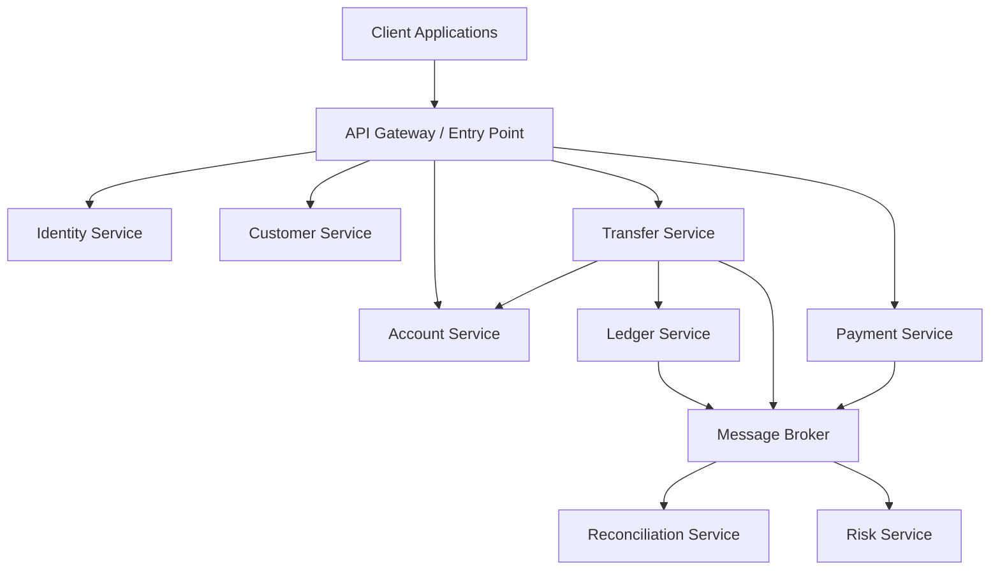

# OpenFin — System Overview

## 1. Introduction

This document describes the intended high-level architecture of OpenFin.

OpenFin will be developed as a microservices-based system. Each service will have a clearly defined responsibility, own its data, and be independently deployable.

The architecture is intended to support independent development, explicit service boundaries, reliable financial processing, and asynchronous workflows.

This is an initial architectural direction. Specific technologies, service boundaries, and communication patterns may evolve as implementation progresses. Decisions that materially affect the architecture should be documented through Architecture Decision Records (ADRs).

## 2. Architectural goals

The architecture should:

1. Separate business capabilities into services with clear responsibilities.
2. Allow services to be developed and deployed independently.
3. Establish explicit ownership of application data.
4. Support synchronous and asynchronous communication.
5. Preserve financial correctness across transaction workflows.
6. Handle duplicate requests and messages safely.
7. Support recovery from partial failures.
8. Provide observability across service boundaries.
9. Allow technologies to be selected based on service requirements.

## 3. Architectural style

OpenFin will use a microservices architecture with event-driven communication where appropriate.

Each service will be maintained in its own Git repository.

A service repository will own its:

- Application source code.
- Dependencies.
- Configuration.
- Database migrations.
- Automated tests.
- API and event contracts.
- Dockerfile and deployment configuration.
- CI/CD workflow.

There will be no shared application monorepo. Cross-service standards and architectural documentation will live in the `openfin-docs` repository.

Services will not access another service's database directly.

## 4. High-level logical architecture

The following diagram represents the intended logical architecture. It does not mean that all these services have been implemented.

The diagram is a conceptual starting point. Actual communication paths and service responsibilities will be refined as individual workflows are designed.

## 5. Service responsibilities

### 5.1 Identity Service

**Responsibility:** Manage authentication and identity-related operations.

Expected responsibilities:

- Customer authentication.
- Password management.
- Token issuance and validation.
- Refresh-token lifecycle.
- Session management.
- Authentication-related security controls.

The Identity Service should not become the owner of customer banking profiles or financial records.

### 5.2 Customer Service

**Responsibility:** Manage customer profile and onboarding information.

Expected responsibilities:

- Customer profile creation and updates.
- Customer status.
- Onboarding workflow.
- Customer information retrieval.

### 5.3 Account Service

**Responsibility:** Manage customer accounts and account lifecycle.

Expected responsibilities:

- Account creation.
- Account ownership.
- Account status.
- Account currency.
- Account metadata.
- Balance visibility and projections.

The Ledger Service remains the authoritative source of financial movements. Any account balance projection must be traceable to ledger activity and have a defined consistency model.

### 5.4 Ledger Service

**Responsibility:** Maintain the authoritative financial record of OpenFin.

Expected responsibilities:

- Ledger accounts.
- Journal transactions.
- Debit and credit entries.
- Atomic posting.
- Balance calculation or projections.
- Reversals and compensating entries.
- Financial audit history.

The Ledger Service must enforce balanced journal posting. A posted transaction must have equal total debits and credits.

Posted financial entries must be immutable.

### 5.5 Transfer Service

**Responsibility:** Coordinate transfers between OpenFin accounts.

Expected responsibilities:

- Transfer initiation.
- Transfer validation and state management.
- Idempotency.
- Interaction with the Ledger Service.
- Transfer lifecycle events.
- Failure recovery.

The Transfer Service coordinates the business workflow. The Ledger Service remains responsible for posting financial entries.

### 5.6 Payment Service

**Responsibility:** Manage payment workflows involving external providers or simulated integrations.

Expected responsibilities:

- Payment initiation.
- Provider communication.
- Provider reference management.
- Payment status tracking.
- Webhook processing.
- Refund workflows.
- Payment-related events.

External provider outcomes must be verified before the system treats an uncertain payment as successful or failed.

### 5.7 Reconciliation Service

**Responsibility:** Compare internal financial records with external or simulated records.

Expected responsibilities:

- Import transaction records.
- Match transactions.
- Detect discrepancies.
- Produce reconciliation results.
- Track unresolved differences.

### 5.8 Risk Service

**Responsibility:** Evaluate transaction activity against defined risk rules.

Potential responsibilities:

- Transaction limit evaluation.
- Velocity checks.
- Suspicious activity detection.
- Risk decision records.
- Transaction review signals.

The service will be introduced when the core transaction lifecycle is established.

## 6. Communication patterns

OpenFin will use two primary communication patterns.

### 6.1 Synchronous communication

Synchronous communication will be used when a service needs an immediate response to continue a request.

Potential mechanisms:

- REST over HTTP.
- gRPC where its benefits justify the additional complexity.

Examples:

- A client authenticating through the Identity Service.
- A Transfer Service requesting an account validation.
- A Transfer Service requesting a ledger operation.

Synchronous calls should have:

- Explicit timeouts.
- Defined error contracts.
- Appropriate authentication.
- Bounded retries where safe.
- Clear ownership of the operation.

A timeout must not be interpreted as proof that a financial operation did not happen.

### 6.2 Asynchronous communication

Asynchronous communication will be used for workflows that do not require an immediate response from every participating service.

Potential mechanisms:

- Message broker.
- Event-driven consumers.
- Background workers.

Examples:

- A completed transfer publishing an event.
- A payment status change triggering downstream processing.
- Reconciliation processing transaction events.
- Risk processing receiving transaction activity.

Events should use a consistent envelope containing appropriate metadata, such as:

- Event ID.
- Event type.
- Event version.
- Occurrence timestamp.
- Source service.
- Correlation ID.
- Payload.

Consumers must be designed to handle duplicate delivery safely.

## 7. Data ownership and persistence

Each service owns its database and is responsible for its schema and migrations.

The intended ownership model is:

| Service | Data owned |
|---|---|
| Identity | Credentials, authentication records, sessions and tokens |
| Customer | Customer profiles and onboarding information |
| Account | Account records, status, ownership and account metadata |
| Ledger | Ledger accounts, journal transactions and entries |
| Transfer | Transfer requests, workflow states and idempotency records |
| Payment | Payment attempts, provider references, webhook records and payment states |
| Reconciliation | Imported records, matching results and discrepancies |
| Risk | Risk rules, evaluations and decisions |

The table represents intended boundaries, not a requirement to create every database immediately.

Services must not query or modify another service's database directly. Data needed by another service should be obtained through APIs or published events.

## 8. Financial correctness

Financial correctness is a core architectural requirement.

### 8.1 Double-entry bookkeeping

Every posted journal transaction must balance:

`Total Debits = Total Credits`

The Ledger Service must validate and persist all entries for a journal transaction atomically.

The invariant must be enforced in the posting workflow, not left to application assumptions.

### 8.2 Immutable financial records

Posted journal entries must not be edited or deleted to correct a financial mistake.

Corrections should be represented through reversal or compensating journal entries, preserving the audit trail.

### 8.3 Monetary representation

Monetary amounts should use integer minor units or an exact decimal representation. Floating-point arithmetic must not be used for financial calculations.

Every monetary amount must have an explicit currency.

### 8.4 Idempotency

Operations that can create financial effects must support idempotent processing.

An idempotency record should be scoped to the relevant customer or account and operation. The system should retain enough request information or a request hash to detect reuse of the same key with a different payload.

A reused key with a different request should be rejected rather than silently treated as the original operation.

### 8.5 Concurrency

The system must prevent concurrent operations from spending the same available funds.

The Ledger Service must use appropriate database transaction and locking strategies to preserve financial invariants under concurrent requests.

## 9. Distributed transaction reliability

A workflow that spans multiple services cannot generally rely on one shared database transaction.

OpenFin will explore patterns that make these workflows reliable.

### Transactional outbox

When a service needs to persist a business change and publish an event, it should record the event intent in the same database transaction as the business change.

A separate publisher can deliver the event to the message broker.

This avoids the failure scenario where the database commits but the event is never published.

### Idempotent consumers

Message delivery may happen more than once.

Consumers should track processed event identifiers or use equivalent deduplication mechanisms so duplicate messages do not cause duplicate business effects.

### Sagas and workflow orchestration

Long-running workflows spanning multiple services may require a Saga or process manager.

A Saga coordinates local transactions and defines how the workflow responds to failures.

This does not replace the atomic ledger posting transaction. Financial posting must remain atomic within the Ledger Service.

### Retry and recovery

Retries must be bounded and based on the type of operation and failure.

Operations with uncertain outcomes must be verified before being repeated. The system should represent pending or unknown states where appropriate rather than assuming every timeout means failure.

## 10. Security

Security will be applied at both service and platform levels.

Initial security considerations include:

- Secure password hashing.
- Authentication and authorization.
- Least-privilege access.
- Service-to-service authentication.
- Input validation.
- Rate limiting.
- Secure secret management.
- Encryption in transit.
- Protection of sensitive data in logs.
- Audit records for sensitive operations.
- Verification of external webhook signatures where supported.

Each service should validate the identity and permissions relevant to the operation it performs. Trust should not be based solely on a request originating from another internal service.

## 11. Observability

The platform should provide enough information to trace operations across service boundaries.

The observability approach will progressively introduce:

- Structured application logs.
- Consistent request and correlation IDs.
- Distributed tracing.
- Service-level metrics.
- Health and readiness checks.
- Error and latency monitoring.
- Queue and event-processing metrics.

Financial workflows should be traceable without exposing passwords, tokens, or sensitive customer information in logs.

## 12. Infrastructure and deployment direction

The initial development environment will use containers and local infrastructure.

The eventual cloud direction is AWS, with services deployed independently.

Potential infrastructure components include:

| Concern | Possible technology |
|---|---|
| Compute | Amazon ECS with Fargate |
| Container registry | Amazon ECR |
| Relational database | Amazon RDS for PostgreSQL |
| Cache | Amazon ElastiCache for Redis |
| Object storage | Amazon S3 |
| Messaging | Amazon MSK or another managed messaging option |
| Queue-based workloads | Amazon SQS where appropriate |
| Secrets | AWS Secrets Manager |
| Encryption keys | AWS KMS |
| Monitoring | Amazon CloudWatch and OpenTelemetry |
| Infrastructure as code | Terraform |
| CI/CD | GitHub Actions |

These are technology candidates, not final implementation commitments. The project should validate the need for each component before adopting it.

## 13. Repository strategy

OpenFin will use a multi-repository structure.

The `openfin-docs` repository is the central location for:

- Product documentation.
- System architecture.
- Service boundaries.
- API and event standards.
- Architecture Decision Records.
- Engineering roadmap.

Each service will have a separate repository created when implementation begins.

For example:

- `openfin-identity-service`
- `openfin-customer-service`
- `openfin-account-service`
- `openfin-ledger-service`
- `openfin-transfer-service`

This list is illustrative. Repositories will be created incrementally as the project requires them.

## 14. Initial implementation strategy

The first meaningful end-to-end financial capability should be a simulated internal transfer.

The intended flow is:

1. An authenticated customer initiates a transfer.
2. The Transfer Service validates the request and idempotency key.
3. The required account and balance checks are performed.
4. The Ledger Service atomically posts the corresponding debit and credit entries.
5. The transfer workflow records the outcome.
6. Relevant events are published and consumed safely.
7. The customer can retrieve the transfer status and transaction history.

The implementation should explicitly test:

- Duplicate requests.
- Reuse of an idempotency key with a different payload.
- Concurrent transfers from the same account.
- Insufficient funds.
- Ledger posting failures.
- Event publication failures.
- Duplicate event delivery.
- Timeouts and uncertain outcomes.

This vertical slice will provide a practical foundation for the more advanced payment and reconciliation workflows.

## 15. Architecture evolution

This document describes the current intended direction, not a permanent architecture.

When implementation reveals a need to change a service boundary, communication pattern, technology, or consistency model, the decision should be documented.

Significant decisions should include:

- Context and problem.
- Decision made.
- Alternatives considered.
- Trade-offs.
- Consequences.

Architecture should evolve from verified engineering needs rather than assumptions made too early.

---

**Document status:** Initial architecture proposal.